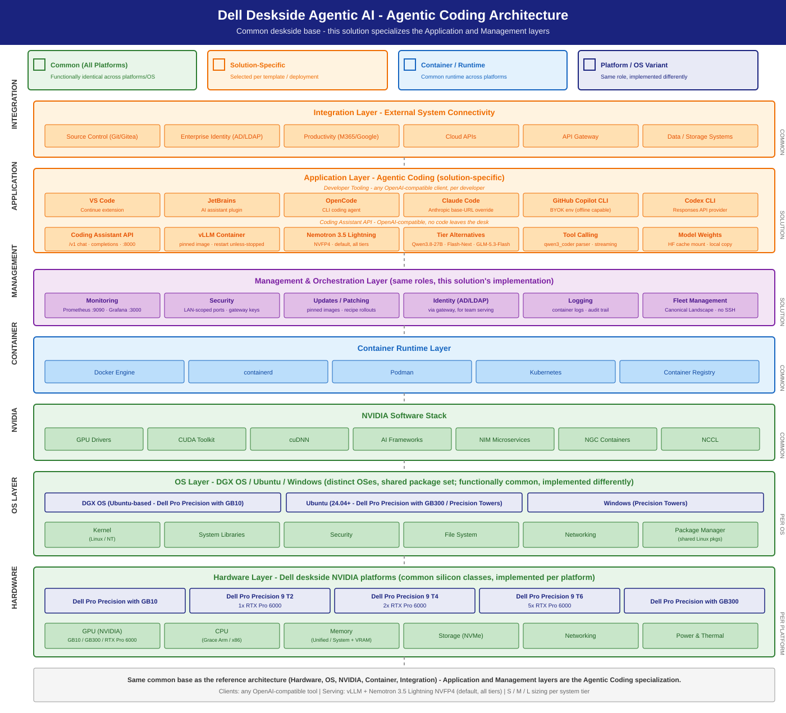

# Agentic Coding Solution

> A private, on-deskside AI coding assistant — code generation, explanation,
> refactoring, and agentic CLI/IDE workflows served locally on Dell hardware
> behind an OpenAI-compatible API.

## Summary

Developers and data scientists want fast, private code assistance without sending
source code to a public cloud. This solution serves a coding-capable LLM on a Dell
deskside system (GB10 / Precision / GB300) and integrates with CLI agents and IDEs
(VS Code, JetBrains) through the standard OpenAI-compatible endpoint. It wraps
NVIDIA's CLI Coding Agent, Vibe Coding, and Local Coding Agent playbooks
and the RTX Local AI playbook hub, with Dell S/M/L sizing and an IT-Admin deployment + management guide.

## Personas

| Persona | What this solution gives them |
|---------|-------------------------------|
| **IT Admin** | One-command deploy, fleet/management guidance, identity & monitoring hooks, dev→prod scaling — see [IT-Admin Guide](it-admin-guide.md). |
| **Functional SME** | "Which system for my team size?" — the S/M/L table below with expected throughput / concurrency. |
| **AI Engineer** | Nemotron default + tier-scaled alternative models, [vLLM](https://github.com/vllm-project/vllm) config, and IDE/CLI integration — see [IDE Integration](ide-integration.md). |

## Reference NVIDIA playbooks

| Playbook | Platform | What Dell adds |
|----------|----------|----------------|
| [CLI Coding Agent](https://build.nvidia.com/spark/cli-coding-agent) | DGX Spark (GB10) | Dell system sizing, vLLM production config, fleet mgmt |
| [Vibe Coding in VS Code](https://build.nvidia.com/spark/vibe-coding) | DGX Spark (GB10) | IDE integration guide for enterprise dev environments |
| [Local Coding Agent](https://build.nvidia.com/station/local-coding-agent) | DGX Station (GB300) | L-tier sizing, multi-user app-host configuration |
| [RTX Local AI hub](https://build.nvidia.com/rtx) | RTX PRO discrete GPUs (Precision towers) | T2/T4/T6 tier recipes and validation (vLLM, multi-GPU, fine-tuning playbooks) |

## Architecture



This solution runs on the common deskside base — the Hardware, OS, NVIDIA
software, container-runtime, and integration layers are identical to the
[base architecture](../../assets/diagrams/deskside-agentic-ai-architecture.svg).
Agentic Coding specializes only the top two layers:

| Layer | In this solution |
|-------|------------------|
| Integration | Source control (Git/Gitea) + enterprise identity (AD/LDAP) via the optional gateway; storage for model weights |
| Application | OpenAI-compatible coding assistant: IDE/CLI clients (VS Code, JetBrains, [OpenCode](https://opencode.ai/), [Claude Code](https://claude.com/claude-code), Copilot CLI, [Codex CLI](https://github.com/openai/codex)) → vLLM serving [Nemotron 3.5 Lightning NVFP4](https://huggingface.co/nvidia/NVIDIA-Nemotron-3.5-Lightning-30B-A3B-NVFP4) (S-tier default; [Nemotron 3.5 Super VL](https://huggingface.co/nvidia/NVIDIA-Nemotron-3.5-Super-VL-120B-A12B-NVFP4) is the M/L default), with per-tier alternatives |
| Management | [Prometheus](https://prometheus.io/) `:9090` + [Grafana](https://grafana.com/) `:3000` serving dashboards, pinned-image recipe rollouts, [Canonical Landscape](https://ubuntu.com/landscape) fleet ops — see [IT-Admin Guide](it-admin-guide.md) |
| Container | [Docker](https://www.docker.com/) Engine (serving recipes); common runtime |
| NVIDIA | GPU drivers, CUDA, cuDNN, NGC containers; common stack |
| OS | DGX OS (GB10) / Ubuntu 24.04+; common |
| Hardware | S: Dell Pro Precision with GB10 / 9 T2 · M: 9 T4 · L: Dell Pro Precision with GB300 / 9 T6 |

A single vLLM container serves a coding model on the Dell deskside system, exposing
`/v1/chat/completions` and `/v1/completions`. CLI agents and IDE extensions connect
via the OpenAI client. Higher tiers add instances / tensor-parallelism and an
optional gateway for multi-user serving.

```
Developer IDE / CLI agent
        │  (OpenAI-compatible API, :8000)
        ▼
   vLLM container  ──►  Coding model (Nemotron default)
        │
   Dell deskside system (S: GB10/T2 · M: T4 · L: GB300/T6)
```

## S / M / L sizing

Two axes wear the S/M/L label: the **sizing** tier (system) and the **model pick**
for that tier. Each sizing tier pins one **default model** and carries one
**tier-scaled alternative** — a larger, same-API model swapped in per workload
(see [Model recommendation](#model-recommendation) for recipes and numbers).

| Tier | Dell system | Model (default · alt) | Quant | vLLM config | Expected (200/200 chat) |
|------|-------------|-----------------|-------|-------------|--------------------------|
| **S** | **Dell Pro Precision with GB10** (128 GB) | Nemotron-3.5-Lightning-30B-A3B · alt [Qwen3.8 27B](https://huggingface.co/nvidia/Qwen3.8-27B-NVFP4) (+ MTP) | NVFP4 | `--moe-backend marlin` + `VLLM_NVFP4_GEMM_BACKEND=marlin` + `--kv-cache-dtype fp8 --max-model-len 200000 --max-num-seqs 32 --gpu-memory-utilization 0.7` | **validated on GB10:** ~66 out tok/s @ c20 (agent-workflow shape, ISL 60k/OSL 1k); chat-shape reference sweep in Validation |
| **S** | **Precision T2** (1× RTX PRO 6000) | Nemotron-3.5-Lightning-30B-A3B · alt [Qwen3.8 27B](https://huggingface.co/nvidia/Qwen3.8-27B-NVFP4) (+ MTP) | NVFP4 | `--moe-backend marlin` + `VLLM_NVFP4_GEMM_BACKEND=marlin` + `--kv-cache-dtype fp8 --max-model-len 200000 --max-num-seqs 512 --gpu-memory-utilization 0.9` | **5,352 chat / 399 agent tok/s** (doc-reported; peak chat / agent @ c20) |
| **M** | **Precision T4** (2× RTX PRO 6000, 192 GB) | [Nemotron 3.5 Super VL](https://huggingface.co/nvidia/NVIDIA-Nemotron-3.5-Super-VL-120B-A12B-NVFP4) · alt [Qwen3.8-Flash-Next](https://huggingface.co/nvidia/Qwen3.8-Flash-Next-NVFP4) | NVFP4 | multi-instance or TP=2; higher concurrency | **168 agent / 1,814 chat tok/s @ c32 / c64** (Super VL TP=2, measured on a T6 host — same GPU pairing) — small team (handful of concurrent devs) |
| **L** | **Dell Pro Precision with GB300** (252 GB HBM3e) | Nemotron 3.5 Super VL · alt [GLM-5.3-Flash](https://huggingface.co/RedHatAI/GLM-5.3-Flash-NVFP4) | NVFP4 | single instance, `--gpu-memory-utilization 0.85 --max-model-len 262144 --max-num-seqs 128` | team / app-host — **225 agent / 3,694 chat tok/s @ c32 / c64** (measured, Super VL) |
| **L** | **Precision T6** (5× RTX PRO 6000, 480 GB) | Nemotron 3.5 Super VL · alt [GLM-5.3-Flash](https://huggingface.co/RedHatAI/GLM-5.3-Flash-NVFP4) | NVFP4 | 2 × TP=2 behind LiteLLM (the measured configuration) or 1 instance per GPU + gateway | team / app-host — **252 agent / 2,020 chat tok/s @ c32 / c64** (measured, 2 × TP=2) |

The **S** row is backed by a measured vLLM benchmark on a GB10 system — see
**Validation** below. M/L rows carry measured serving numbers for the models
they name; the concurrency figures are planning guidance for your pilot to
tune.

### Scaling decision table

When to move to the next tier — based on measured S-tier performance:

| Condition (observed at current tier) | Action |
|-------------------------------------|--------|
| TTFT p95 < 500 ms at your peak concurrency | **Stay** — current tier has headroom |
| TTFT p95 > 1 s at peak concurrency | **Scale up** — move to next tier |
| Waiting-request queue sustained > 0 | **Scale up** — requests are queuing |
| Need > 8 concurrent coding sessions | **Move S → M** (multi-instance or TP=2 on 2× RTX PRO 6000) |
| Need > 16 concurrent coding sessions | **Move M → L** (multi-instance or GB300) |
| Need more context than 200K, or a larger model | **Move to L** (GB300 Super VL serves a 262K window; GLM-5.3-Flash alternative on GB300/T6) |

**S-tier reference data** (GB10, 200/200 chat shape on the prior reference model):

| Concurrent devs | TTFT (ms) | ITL (ms) | Per-session output tok/s | Aggregate output tok/s | UX quality |
|----------------:|----------:|---------:|-------------------------:|-----------------------:|------------|
| 1 | ~113 | ~16.7 | 58 | 58 | Excellent |
| 4 | ~267 | ~24.1 | ~40 | 158 | Good |
| 8 | ~348 | ~33.5 | ~29 | 228 | Acceptable |
| 16 | ~583 | ~47.1 | ~20 | 321 | Marginal (move to M) |

**Multi-instance guidance (L tier):** on the Precision T6 (5× RTX PRO 6000),
run one vLLM instance per GPU behind a [LiteLLM](https://www.litellm.ai/) proxy for load balancing.
This avoids tensor-parallelism over PCIe (slow) and gives 5× the
single-GPU capacity. See [IT-Admin Guide](it-admin-guide.md).

### Measured agentic capacity by tier (agent shape: 60k-token prompts, 1k output)

Every tier-and-model combination with a measured agent-shape ladder, one row each.
The sessions columns give the concurrency at which per-session output (aggregate / C,
log-log interpolated on the measured ladder) crosses the stated floor; aggregate is
quoted at c32 unless noted. Raw ladders in [`tests/data/`](https://github.com/dell/deskside-agentic-ai/tree/main/tests/data),
machine-readable record [`tests/data/latest/sizing.yaml`](https://github.com/dell/deskside-agentic-ai/blob/main/tests/data/latest/sizing.yaml);
the Recipe Configuration panel in the [IT-Admin Guide](it-admin-guide.md) shows the
full ladder for any platform and model.

| Tier | Platform and topology | Model | Sessions at 20 tok/s | Sessions at 10 tok/s | Aggregate tok/s at c32 |
|------|-----------------------|-------|---------------------:|---------------------:|-----------------------:|
| S | GB10, 1 instance | Nemotron 3.5 Lightning | ~1.9 | ~3.8 | 38 at c4 (ladder ended at c4) |
| M | T4 (2 GPUs), 1 instance TP=2 | Nemotron 3.5 Super VL | ~6 | ~15 | 168 |
| L | T6 (4 of 5 GPUs), 2 × TP=2 behind LiteLLM | Nemotron 3.5 Super VL | ~11 | ~24 | 252 |
| L | GB300, 1 instance | Nemotron 3.5 Super VL | ~10 | ~22 | 225 |
| L | GB300, 1 instance | Nemotron 3.5 Lightning | ~17 | ~33 | 332 |

Agent-shape prompts are prefill-heavy, so a GB300 instance is no faster than two TP=2 replicas on a tower for this shape;
pick the topology per workload ([topology](../../docs/topology.md)).

**How to read these numbers.** They are hardware concurrency at a responsiveness
floor — how many simultaneous agent sessions a platform sustains above the floor.
Translating sessions into seats is a team-shape judgement (desk coverage,
utilisation, sessions per person), not a measured figure: make it in your pilot
plan, and compute cost from your own cloud rate, hardware price, and the
utilisation the tokenomics dashboard measures
([`monitoring/`](../../monitoring/README.md), included with every recipe).
Alternative models (Qwen3.8-Flash-Next, GLM-5.3-Flash, Qwen3.8 27B) publish their
serving-verification numbers in the [Inference Stack](../../docs/stack.md).

**Traceability.** Scripts, data, and tests are in [`tests/`](https://github.com/dell/deskside-agentic-ai/blob/main/tests/README.md);
`tests/aiperf/` holds the ladder configuration and the exact commands.

## Model recommendation

- **Default:** **Nemotron family**, scaled per tier. On **S**:
  `nvidia/NVIDIA-Nemotron-3.5-Lightning-30B-A3B-NVFP4`
  (validated on GB10: marlin MoE + NVFP4 GEMM backends, ~66 out tok/s @ c20 on
  agent-workflow load). On **M and L**: **Nemotron 3.5 Super VL** (default;
  `recipes/precision/vllm/docker-nemotron-3.5-super-vl-nvfp4.sh`,
  `recipes/gb300/vllm/docker-nemotron-3.5-super-vl-nvfp4.sh`; Lightning at higher concurrency /
  multi-instance is the measured alternative). MoE, NVFP4, tool-calling capable, reasoning model —
  give clients `max_tokens >= 512` (smaller budgets are eaten by the thinking
  trace).
- **Alternatives (one per tier, same OpenAI-compatible API):**
  - **Qwen3.8 27B (NVFP4 + MTP)** — S-tier alternative on GB10: dense 27B
    NVFP4 with MTP speculative decode baked in
    (`--speculative-config '{"method":"mtp","num_speculative_tokens":2}'`),
    full 262K context with FP8 KV; ~62–65 out tok/s single-stream measured
    on GB10. Recipe:
    `recipes/gb10/vllm/docker-qwen3.8-27b-nvfp4.sh`. Same reasoning-model
    client rule: `max_tokens >= 512`.
  - **Qwen3.8-Flash-Next (NVFP4)** — M-tier alternative: 125B-total / ~6B-active
    MoE with MTP ×3 and the 51B n-gram table CPU-offloaded
    (`--engram-config '{"cpu_offload":true}'`, needs ≥128 GB host RAM), native
    262K context. Serving verified (chat + tool calling pass; ~310 out tok/s
    single-stream spot check on a warm instance). Recipe:
    `recipes/precision/vllm/docker-qwen3.8-flash-next-nvfp4.sh`.
  - **GLM-5.3-Flash (NVFP4)** — L-tier alternative on GB300: 320B-total /
    18B-active MoE, ~181 GiB NVFP4 on one 252 GB GB300 with FP8 KV, 262K
    context, `glm47` tool + `glm45` reasoning parsers. Serving verified (chat +
    tool calling pass; ~111 out tok/s single-stream spot check). Recipe:
    `recipes/gb300/vllm/docker-glm-5.3-flash-nvfp4.sh`.

Refreshed as new open-weight coding models are released. Last updated 10/16/2026.

## Inference stack

**vLLM (preferred).** OpenAI-compatible, production-grade, the basis for all
sizing benchmarks. Ollama is the developer quick-start reference; NIM is the
containerized/enterprise-support option. See [Inference Stack & Models](../../docs/stack.md).

## Deployment

S-tier (GB10), one command:

```bash
# Serve the default coding model on a Dell deskside system powered by NVIDIA GB10
recipes/gb10/vllm/docker-nemotron-3.5-lightning-nvfp4.sh --port 8000

# Verify
curl -s http://localhost:8000/v1/models

# Smoke-test a completion (reasoning model: keep max_tokens >= 512)
curl -s http://localhost:8000/v1/chat/completions \
  -H 'Content-Type: application/json' \
  -d '{"model":"nvidia/nemotron-3.5-lightning","messages":[{"role":"user","content":"Write a Python function to reverse a string."}],"max_tokens":1024}'
```

Other platforms (Precision T2/T4, GB300): see the
[recipe catalog](../../recipes/README.md).

Full setup/management/scaling: [IT-Admin Guide](it-admin-guide.md).
IDE & CLI agent integration: [IDE Integration](ide-integration.md).
Fleet rollout without SSH (Canonical Landscape): [Fleet Deploy via Landscape](landscape-fleet-deploy.md).

## Management environment

- **Identity:** front the endpoint with the org's gateway / reverse proxy for
  AD/LDAP-backed auth (app-host / multi-user tiers).
- **Monitoring:** scrape vLLM `/metrics` with Prometheus; Grafana dashboards for
  tokens/sec, TTFT, queue depth.
- **Fleet:** containerized deploy (Docker/Podman or NIM) for reproducibility;
  scale dev→prod by adding instances (M/L) behind the gateway. For fleets of
  enrolled Ubuntu machines, roll the recipes out centrally with
  [Fleet Deploy via Landscape](landscape-fleet-deploy.md) (SSH-less, audited via Landscape activity log).

## Validation (aiperf)

**S tier chat validated on a Dell Pro Precision with GB10 with the prior reference
model** (the shipping default is Lightning —
its GB10-validated config and agent-shape numbers are in the recipe header) —
a clean interactive-chat (200/200) sweep across the 1→16 concurrency ladder,
**0 errors**, using the stable serving config (`--moe-backend cutlass` +
`--max-num-seqs 16` + prefix caching on the Dell GB10 vLLM build):

| Concurrency | TTFT (ms) | ITL (ms) | Per-session output tok/s | Aggregate output tok/s | Req/s |
|------------:|----------:|---------:|-------------------------:|-----------------------:|------:|
| 1  | 113 | 16.7 | 58  | 58  | 0.29 |
| 4  | 267 | 24.1 | ~40 | 158 | 0.79 |
| 16 | 583 | 47.1 | ~20 | 321 | 1.61 |

- **Resolved:** the earlier stock-image NVFP4 MoE instability under concurrency is
  fixed by pinning the MoE backend (`cutlass` on the Dell GB10 build used for
  this sweep; the shipping Lightning recipes use `marlin` on public images).

## Dependencies & Risk factors

- **Dependencies:** NVIDIA
  CLI Coding Agent playbook; vLLM on GB10; Nemotron coding model
  availability; Dell GB10 hardware.
- **Risk factors:** vLLM-on-GB10 NVFP4 stability requires an explicit MoE backend
  pin (`cutlass` on the Dell GB10 build; `marlin` on the public-image Lightning
  recipes);
  model recommendations evolve with the Nemotron family and new open-weights
  coding models.
