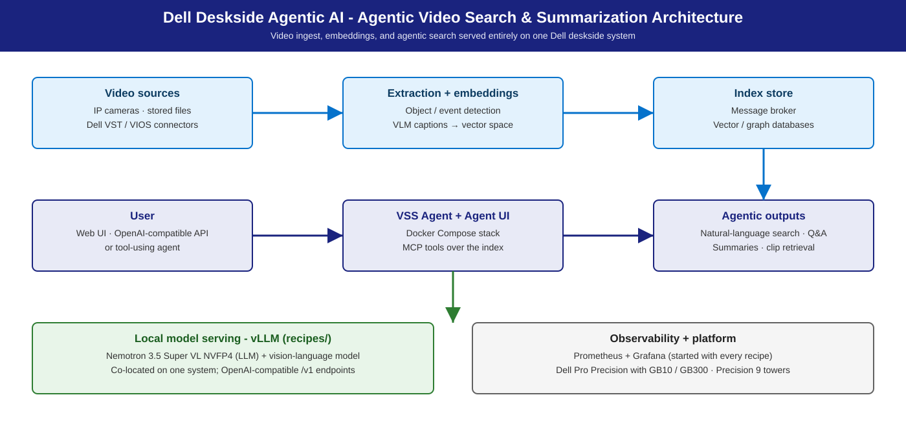

# Agentic Video Search & Summarization

**Turn raw video into searchable, summarized, queryable insight — locally.**

## Summary

Deploy NVIDIA's Video Search and Summarization (VSS) AI Blueprint on Dell
deskside systems: a local vision-language model plus a locally-served LLM
for natural-language search, timestamped summarization, and event detection
over your own footage — no cloud dependency, no data-residency
risk. Dell adds S/M/L sizing (GB10 · RTX PRO 6000 towers · GB300), a pinned
LLM lineup on [vLLM](https://github.com/vllm-project/vllm), recipes, and deployment guides.

## Personas

| Persona | What this solution gives them |
|---------|-------------------------------|
| **IT Admin** | Per-host install, per-tier models, fleet automation, monitoring & storage — [IT-Admin Guide](it-admin-guide.md). |
| **Functional SME** | "Which system for my team / camera count?" — S/M/L tables below. |
| **AI Engineer** | Nemotron default + tier-scaled alternates, VLM pairing, hybrid vLLM configs — [Developer Deploy Guide](deploy-guide-dev.md). |

## Reference NVIDIA playbooks

| Playbook | Platform | What Dell adds |
|----------|----------|----------------|
| [VSS Blueprint (NVIDIA-AI-Blueprints)](https://github.com/NVIDIA-AI-Blueprints/video-search-and-summarization) | RTX PRO / DGX-class GPU systems | S/M/L sizing, per-tier LLM lineup, hybrid vLLM config, fleet guide |
| [RTX Local AI hub](https://build.nvidia.com/rtx) | RTX PRO discrete GPUs (Precision towers) | vLLM recipes + measured validation for the LLM half |

## Use cases

| Use case | Who | What it looks like |
|----------|-----|--------------------|
| **Security & surveillance review** | Physical security, loss prevention | *"Show me anyone approaching the loading dock after 9 PM"* → timestamped clips; footage never leaves the site. |
| **Retail & manufacturing analytics** | Retail ops, QA, plant managers | Continuous YOLO26 detection + event summarization + aggregate NL questions over the stream. |
| **Media archive intelligence** | Broadcasters, media, comms | NL search over large archives, timestamped clip retrieval. |
| **Compliance & incident review** | Compliance, legal, investigations | Hours of footage → event timeline; alerts verified against ground truth. |
| **Multi-modal research** | Research teams | Vision + audio + language reasoning over recorded content. |

Upstream profiles: `base` (search, Q&A, clip retrieval),
`alert-verification` (compliance), `real-time-alerts` (continuous ingest +
alerts). What this solution is **not**: a hosted SaaS; a CCTV replacement
(consumes existing cameras, doesn't manage them); a general-purpose agent
runtime (see our [OpenClaw on NemoClaw](../openclaw-on-nemoclaw/)
solution);
face recognition (identity is a per-site policy call).

## Architecture



Three upstream areas: **real-time video intelligence** (VIOS / VST
extraction, embeddings → message broker); **downstream analytics**
(trajectories, incidents, verified alerts); **agentic & offline processing**
(search, Q&A, summarization, clip retrieval via MCP).

```
   User (Web UI, API, or agent)
             │
             ▼
   VSS Agent + VSS Agent UI (Docker Compose)
             │
             ├──► VIOS / VST (video ingest + embeddings)
             │        └──► Message broker + vector / graph DB
             │                 └──► Analytics (trajectories, incidents, alerts)
             │
             ├──► VLM (vision-language) — Nemotron 3 Nano Omni · vLLM
             │
             └──► LLM (summarization / Q&A) — Nemotron 3.5 Lightning · vLLM

   Dell deskside system (S: GB10 / T2 · M: Dell Pro Precision 9 T4 · L: Dell Pro Precision with GB300)
```

Key containers: VSS Agent + UI, VIOS / VST, LLM + VLM (vLLM), Phoenix.
Mode: **Standard VSS (hybrid)** — both models served as local vLLM
endpoints on one GPU (`--use-remote-llm`, `--use-remote-vlm`).

## S / M / L sizing

Three sizing axes: **LLM concurrency**, **VLM ingestion throughput**,
**video storage**; YOLO26 per-camera FPS adds a camera-count limit.

### LLM (summarization, Q&A, alert reasoning)

| Tier | Dell system | Model (default · alt) | vLLM config | Expected |
|------|-------------|------------------------|-------------|----------|
| **S** | **Dell Pro Precision with GB10** (128 GB unified) | [Nemotron 3.5 Lightning](https://huggingface.co/nvidia/NVIDIA-Nemotron-3.5-Lightning-30B-A3B-NVFP4) 30B A3B · alt [Qwen3.8 27B](https://huggingface.co/nvidia/Qwen3.8-27B-NVFP4) | local, co-located at `--gpu-memory-utilization 0.35` | Comfort c2–c4 at this footprint (planning estimate); prior-model reference (Nano 30B): ~573 agg. @ c128. Lightning default measured cells: [agentic-coding Sizing](../agentic-coding/README.md) ([Benchmarks](#benchmarks-performance-validation)) |
| **S** | **Dell Pro Precision 9 T2** (1× RTX PRO 6000, 96 GB) | [Nemotron 3.5 Lightning](https://huggingface.co/nvidia/NVIDIA-Nemotron-3.5-Lightning-30B-A3B-NVFP4) 30B A3B · alt [Qwen3.8 27B](https://huggingface.co/nvidia/Qwen3.8-27B-NVFP4) | local, co-located at `--gpu-memory-utilization 0.35` | Comfort c2–c4 at this footprint (planning estimate); prior-model reference (Nano 30B): ~301 out tok/s @ c4. Lightning default measured cells: [agentic-coding Sizing](../agentic-coding/README.md) ([Benchmarks](#benchmarks-performance-validation)) |
| **M** | **Dell Pro Precision 9 T4** (2× RTX PRO 6000) | [Nemotron 3.5 Super VL](https://huggingface.co/nvidia/NVIDIA-Nemotron-3.5-Super-VL-120B-A12B-NVFP4) · alt [Qwen3.8-Flash-Next](https://huggingface.co/nvidia/Qwen3.8-Flash-Next-NVFP4) | TP or multi-instance; higher concurrency | Small team — planning estimate ([Benchmarks](#benchmarks-performance-validation)) |
| **L** | **Dell Pro Precision with GB300** (252 GB HBM3e, aarch64) | Nemotron 3.5 Super VL · alt [GLM-5.3-Flash](https://huggingface.co/RedHatAI/GLM-5.3-Flash-NVFP4) | Multi-instance or TP; gateway | Multi-user / large corpus — planning estimate ([Benchmarks](#benchmarks-performance-validation)) |

### VLM (all tiers)

[Nemotron 3 Nano Omni](https://huggingface.co/nvidia/nemotron-3-nano-omni-30b-a3b) 30B A3B on local vLLM at every tier (TP /
multi-instance on M/L).

### Object detection (YOLO26, measured)

All runs FP16 TensorRT; camera counts assume 15 FPS per camera.

| Tier / system | Model | FPS | mAP50-95 | Camera capacity |
|---------------|-------|----:|---------:|----------------:|
| **S — T2** | yolo26n | 727 | 0.395 | ~48 cameras |
| **S — T2** | yolo26m | 332 | 0.518 | ~22 cameras |
| **S — T2** | yolo26x | 193 | 0.563 | ~12 cameras |
| **S — GB10** | yolo26n | 341 | 0.395 | ~22 cameras |
| **S — GB10** | yolo26m | 107 | 0.518 | ~7 cameras |
| **S — GB10** | yolo26x | 58 | 0.563 | ~3 cameras |

All variants beat real-time (> 30 FPS); T2 ~2× faster than GB10 for pure
vision, accuracy identical. Pick the smallest variant meeting the accuracy
floor.

### Video storage (second sizing axis)

GB/hour depends on your footage — measure early on actual footage. Planning
bands: local disk for short-retention S tier; NAS for shared 30-day corpora
and M tier; S3-compatible store for 90+ day / L-tier archives. Index size
runs 5–15 % of raw video. Tier memory:
[S/M/L Sizing](../../docs/sizing.md).

## Model recommendation

- **LLM default — Nemotron family, per tier.** **S:**
  [`nvidia/NVIDIA-Nemotron-3.5-Lightning-30B-A3B-NVFP4`](https://huggingface.co/nvidia/NVIDIA-Nemotron-3.5-Lightning-30B-A3B-NVFP4)
  (MoE, NVFP4, reasoning + tool calling — give clients `max_tokens >= 512`).
  **M/L:** Nemotron 3.5 Super VL.
- **Alternatives (one per tier; recipes in
  [Deployment recipes](#deployment-recipes)):**
  - **S — [`nvidia/Qwen3.8-27B-NVFP4`](https://huggingface.co/nvidia/Qwen3.8-27B-NVFP4):**
    dense 27B NVFP4, MTP speculative decode.
  - **M — [`nvidia/Qwen3.8-Flash-Next-NVFP4`](https://huggingface.co/nvidia/Qwen3.8-Flash-Next-NVFP4):**
    MoE, MTP, CPU-offloaded n-gram table (≥128 GB host RAM).
  - **L — [`RedHatAI/GLM-5.3-Flash-NVFP4`](https://huggingface.co/RedHatAI/GLM-5.3-Flash-NVFP4):**
    320B-total / 18B-active MoE; ~181 GiB NVFP4 fits one 252 GB GB300 with
    FP8 KV.
- **VLM pairing (all tiers):** Nemotron 3 Nano Omni 30B A3B
  ([`nvidia/nemotron-3-nano-omni-30b-a3b`](https://huggingface.co/nvidia/nemotron-3-nano-omni-30b-a3b)), local vLLM — vision + audio +
  language jointly. Inline commands in
  [Developer Deploy Guide](deploy-guide-dev.md).

Pin per system for reproducibility; alternatives trade VRAM footprint
against caption / summary quality.

## Inference stack

**vLLM-based serving.** LLM and VLM run as containerized vLLM servers
(public [`vllm/vllm-openai`](https://docs.vllm.ai/) image); hybrid mode
points VSS at them via `--use-remote-llm` / `--use-remote-vlm`. NVFP4 MoE
models need the Marlin pin on public images (`--moe-backend marlin` +
`VLLM_NVFP4_GEMM_BACKEND=marlin`), as the Lightning recipes bake. Domain
fine-tunes via `VLM_CUSTOM_WEIGHTS=<path>`. See
[Inference Stack & Models](../../docs/stack.md).

## Deployment recipes

| Tier | Standalone LLM serving (full-GPU configs baked) |
|------|--------------------------------------------------|
| **S** | [`gb10 · Lightning`](https://github.com/dell/deskside-agentic-ai/blob/main/recipes/gb10/vllm/docker-nemotron-3.5-lightning-nvfp4.sh) · [`gb10 · Qwen3.8-27B`](https://github.com/dell/deskside-agentic-ai/blob/main/recipes/gb10/vllm/docker-qwen3.8-27b-nvfp4.sh) |
| **M** | [`precision · Lightning`](https://github.com/dell/deskside-agentic-ai/blob/main/recipes/precision/vllm/docker-nemotron-3.5-lightning-nvfp4.sh) · [`precision · Qwen3.8-Flash-Next`](https://github.com/dell/deskside-agentic-ai/blob/main/recipes/precision/vllm/docker-qwen3.8-flash-next-nvfp4.sh) |
| **L** | [`gb300 · Lightning`](https://github.com/dell/deskside-agentic-ai/blob/main/recipes/gb300/vllm/docker-nemotron-3.5-lightning-nvfp4.sh) · [`gb300 · GLM-5.3-Flash`](https://github.com/dell/deskside-agentic-ai/blob/main/recipes/gb300/vllm/docker-glm-5.3-flash-nvfp4.sh) |

Inside the VSS hybrid stack the LLM is co-located with the VLM at `0.35`
utilization — the inline command in [Developer Deploy Guide](deploy-guide-dev.md)
is that variant. Full flow in the developer guide.

## Benchmarks & performance (validation)

### LLM concurrency — S tier measured (prior reference models, 200 in / 1000 out)

**Dell Pro Precision 9 T2** (Nemotron 3 Nano 30B A3B NVFP4) — interactive
comfort **c2–c4**, large TTFT tail at c8:

| Concurrency | TTFT | Output tok/s | Notes |
|-------------|------|--------------|-------|
| 1 | ~29 ms | 80 | Excellent |
| 2 | ~41 ms | 159 | Excellent |
| 4 | ~47 ms | 301 | Good — interactive comfort |
| 8 | ~11,575 ms | 301 | **Large TTFT tail; move to c4 or up-tier** |

**Dell Pro Precision with GB10** (Nemotron Nano 9B v2 FP8) — comfort
**c2–c4**, acceptable through c16 (~16 tok/s per session):

| Concurrency | TTFT | Aggregate tok/s | Per-session tok/s | Notes |
|-------------|------|-----------------|----------------|-------|
| 1 | ~72 ms | 23 | 23 | Excellent |
| 2 | ~97 ms | 47 | 24 | Excellent |
| 4 | ~119 ms | 89 | 22 | Good — interactive comfort |
| 8 | ~125 ms | 158 | 20 | Acceptable |
| 16 | ~355 ms | 256 | 16 | Marginal |
| 32 | ~333 ms | 375 | 12 | TTFT still low; per-session degrades |
| 64 | ~752 ms | 491 | 8 | Batch-only |
| 128 | ~1,985 ms | 573 | 4 | Batch-only |

**M / L (planning estimate, not benchmarked for VSS):** scale the S envelope — M ~2×, L ~3–4×
S-tier concurrency at similar TTFT — and confirm with the promotion gates below.

### GPU memory co-location (S tier, measured on T2)

Peak co-located GPU memory **68.3 GB of 96 GB** (71.4 %), both containers at
`--gpu-memory-utilization 0.35`. **VLM must start first** — vLLM needs free
GPU at startup.

### Planning notes

Plan a **video-ingest headroom** buffer of 20–30 % on peak ingestion.
Detection capacity is measured — YOLO26 table above.

## Management environment

- **Storage:** corpus + vector / graph indices sized against retention;
  disk, NAS, and S3-compatible stores all supported upstream.
- **Monitoring:** [Prometheus](https://prometheus.io/) on vLLM `/metrics` (both containers); DCGM GPU
  telemetry; Phoenix for VSS ingestion; [Grafana](https://grafana.com/) panels for VLM ingest
  (chunks / sec), summarization latency, storage growth.
- **Identity:** org gateway with AD/LDAP-backed auth in front of the VSS UI
  (port 7777) on multi-user tiers.
- **Data handling:** video at rest may be sensitive — document retention,
  encryption at rest, access control, and audit trail before rollout.

## Promotion gates

**Promotion gates (S → M → L)** — promote only when all pass: healthy endpoint through the full sweep; error rate ≤ 1 %;
p99 latency meets the use-case SLO; sustained tok/s and req/s on target; ≥ 2 consistent runs. A failed gate holds the
tier and gets documented.

## Dependencies & Risk factors

- **Dependencies:** upstream VSS Blueprint ([Docker](https://www.docker.com/) Compose; Docker CE
  version-sensitive); vLLM on GB10 / Precision / GB300; Nemotron LLM + Omni
  VLM availability; NGC + [Hugging Face](https://huggingface.co/) credentials; Container Toolkit.
- **Risk factors:** M/L sizing is scaled from S; storage sizing depends on your footage; NVFP4
  MoE on public images requires the Marlin backend pin.

## Related

- [Developer Deploy Guide](deploy-guide-dev.md) · [IT-Admin Guide](it-admin-guide.md) · [Agentic Coding](../agentic-coding/)
- [sizing](../../docs/sizing.md) · [stack](../../docs/stack.md) · [personas](../../docs/personas.md) · [glossary](../../docs/glossary.md) · [recipe catalog](../../recipes/README.md) · [repo home](../../README.md)
