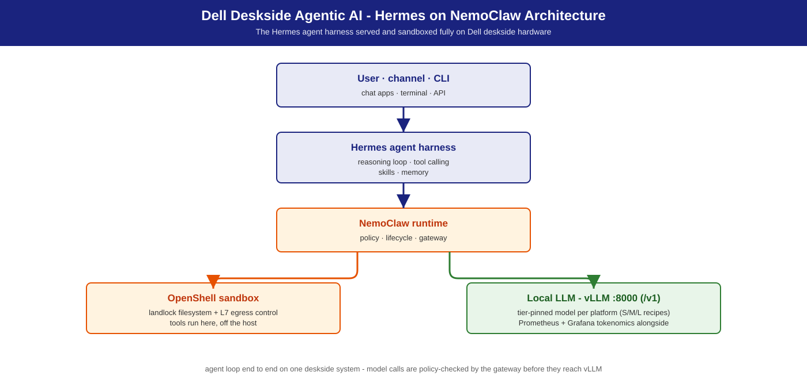

# Hermes on NemoClaw

**Tool-using AI agents as a product, running fully on-premise on Dell workstations — policy-bounded agent sessions, sandboxed tools, and private inference on a single deskside system.**

## Summary

[Hermes Agent](https://hermes-agent.nousresearch.com/), built by
[Nous Research](https://nousresearch.com/), is the tool-using agent harness this
solution deploys: a policy-bounded autonomous agent that reasons with a
locally-served LLM ([vLLM](https://github.com/vllm-project/vllm),
OpenAI-compatible), calls external tools through the
[Model Context Protocol](https://modelcontextprotocol.io/) (MCP), and keeps
skills and memory across sessions. It runs **on the
[NemoClaw](https://github.com/NVIDIA/NemoClaw) runtime** — [NemoClaw](https://github.com/NVIDIA/NemoClaw) supplies
policy, lifecycle, and the gateway; the [OpenShell](https://github.com/NVIDIA/OpenShell)
sandbox supplies filesystem landlock and L7 egress boundaries. Everything runs
on one Dell deskside system; no cloud dependency for the model path.

This solution is the deployment path for [Hermes](https://hermes-agent.nousresearch.com/) on Dell S / M /
L tiers: validated sizing, one-command serving recipes, and an IT-Admin fleet
guide. The same local endpoint (`http://localhost:8000/v1`) also serves the
[Agentic Coding](../agentic-coding/) solution on the same box. For the base
runtime with its default [OpenClaw](https://openclaw.ai/) agent, see [OpenClaw on NemoClaw](../openclaw-on-nemoclaw/).

**What this is *not*:** an IDE autocomplete solution (that is
[Agentic Coding](../agentic-coding/)), nor an unrestricted internet agent
— policy and egress boundaries are the point.

## Personas

| Persona | What this solution gives them |
|---------|-------------------------------|
| **IT Admin** | Two-plane install (serving + agent), policy tiers, identity and monitoring hooks — [IT-Admin Guide](it-admin-guide.md). |
| **Functional SME** | "How many analysts can share this box?" — the S/M/L table below with measured concurrent-agent envelopes. |
| **AI Engineer** | Tool-calling model lineup, [vLLM](https://github.com/vllm-project/vllm) flags, MCP tool wiring, smoke tests — [Developer Deploy Guide](deploy-guide-dev.md). |

Terms: [Glossary](../../docs/glossary.md).

## Reference NVIDIA playbooks

| Playbook | Platform | What Dell adds |
|----------|----------|----------------|
| [Run Hermes Agent with a Local LLM](https://build.nvidia.com/spark/hermes-agent) | DGX Spark (GB10) | Dell S/M/L sizing, vLLM recipes, validated agent concurrency envelopes, fleet guide |
| [RTX Local AI hub](https://build.nvidia.com/rtx) | RTX PRO discrete GPUs (Dell Pro Precision 9 T2 / T4 / T6 towers) | Tower-tier serving recipes + validation |

## Use cases

Use cases this solution enables (NVIDIA NemoClaw / Hermes positioning, mapped
onto Dell tiers with local vLLM):

| Use case | What it looks like |
|----------|--------------------|
| **Controlled agent rollout** | Try agent behavior behind explicit filesystem and network boundaries before widening access. |
| **Managed tool / MCP access** | Connect authenticated tools (docs, tickets, repos) without leaving raw credentials in the sandbox. |
| **Headless / remote Linux deploy** | Always-on agent on a deskside or lab host. |
| **Sales / product research** | Mix internal mail, chat, and docs with approved external research under egress lock. |
| **Engineering triage** | GitHub, CI, and log investigation with a sandboxed shell and repo tools. |
| **Support desk / knowledge discovery** | Draft answers from internal knowledge plus approved connectors; PII stays on site. |
| **Multi-agent / team workflows** | Specialized agents collaborating under one governed runtime. |

Deskside pitch: you feel the agent on **your own** GPU, not a shared
cloud tenant.

## Architecture



The agent loop, end to end:

```
        User / channel / CLI
                │
                ▼
        Hermes agent   ── harness: reasoning loop,
                │          tool-calling, skills, memory
                ▼
        NemoClaw runtime ── policy, lifecycle, gateway
                │
    ┌───────────┴────────────────┐
    ▼                            ▼
 OpenShell sandbox         Local LLM — vLLM :8000 (/v1)
 (landlock + L7 egress)         │
    │                           ▼
    ▼                    Nemotron 3.5 Lightning (NVFP4)
 MCP tool servers
 (files, git, tickets, APIs)

        Dell deskside workstation (S / M / L tier)
_Commands in this guide run from the repository root (`git clone` this repo and `cd` into it)._

```

### Two-plane deployment

| Plane | Contents | Install path |
|-------|----------|--------------|
| **1 — Inference + observability** | vLLM (Nemotron) + [Prometheus](https://prometheus.io/) + [Grafana](https://grafana.com/) | Recipe under [`recipes/`](../../recipes/) + [Docker](https://www.docker.com/) Compose |
| **2 — Agent** | NemoClaw installer → [OpenShell](https://github.com/NVIDIA/OpenShell) + Hermes sandbox | NVIDIA installer, then `nemohermes` (inline steps in the guides) |

Plane 1 is reusable across solutions — the same `http://localhost:8000/v1`
endpoint serves Hermes, coding assistants, and [Agentic Video Search & Summarization](../agentic-vss/)
on one box.

### Key components

| Component | Role |
|-----------|------|
| **Hermes** | Tool-using agent harness — tool-calling loop, policy execution, self-improving skills / memory (runs on NemoClaw) |
| **NemoClaw** | Agent runtime and lifecycle manager — the base plane ([OpenClaw on NemoClaw](../openclaw-on-nemoclaw/)) |
| **OpenShell** | Secure sandbox — long-running agent session isolation |
| **vLLM** | Local inference server — OpenAI-compatible API ([docs.vllm.ai](https://docs.vllm.ai/)) |
| **MCP server(s)** | Tool orchestration via [Model Context Protocol](https://modelcontextprotocol.io/) |
| **[Nemotron 3.5 Lightning NVFP4](https://huggingface.co/nvidia/NVIDIA-Nemotron-3.5-Lightning-30B-A3B-NVFP4)** | Default agent LLM — tool-calling capable, MoE, 30 B total / ~3 B active |

## S / M / L sizing

Agent workloads have **variable, stateful resource consumption** — these are
conservative baselines from measured tool-using agent ladders. One Hermes task
≈ several sequential LLM calls plus tool executions, so **serving concurrency ≠
agent concurrency**; size from the agent column, not raw tokens/sec. Sizing
framework: [S/M/L Sizing](../../docs/sizing.md).

| Tier | Dell system | GPU / memory | Model (default · alt) | Concurrent Hermes agents |
|------|-------------|--------------|------------------------|--------------------------|
| **S** | **Dell Pro Precision with GB10** | GB10 Grace-Blackwell · 128 GB unified · aarch64 | Nemotron-3.5-Lightning-30B-A3B · alt [Qwen3.8 27B](https://huggingface.co/nvidia/Qwen3.8-27B-NVFP4) | **1 – 2** interactive (4 pass, p50 ≤ ~23 s) |
| **M** | **Dell Pro Precision 9 T4 with RTX PRO 6000** · multi-instance or TP | 1–2× RTX PRO 6000 (96 / 192 GB) | [Nemotron 3.5 Super VL](https://huggingface.co/nvidia/NVIDIA-Nemotron-3.5-Super-VL-120B-A12B-NVFP4) · alt [Qwen3.8-Flash-Next](https://huggingface.co/nvidia/Qwen3.8-Flash-Next-NVFP4) | **1 – 4** (1× card: fastest measured wall-time) |
| **L** | **Dell Pro Precision with GB300** | GB300 252 GB HBM3e · aarch64 | Nemotron 3.5 Super VL · alt [GLM-5.3-Flash](https://huggingface.co/RedHatAI/GLM-5.3-Flash-NVFP4) | **1 – 4+** (flat p50) |
| **L** | **Dell Pro Precision 9 T6** | up to 5× RTX PRO 6000 (480 GB) | Nemotron 3.5 Super VL · alt [GLM-5.3-Flash](https://huggingface.co/RedHatAI/GLM-5.3-Flash-NVFP4) | **1 – 4** per GPU |

## Model recommendation

- **Default: Nemotron family, scaled per tier.**
  [`nvidia/NVIDIA-Nemotron-3.5-Lightning-30B-A3B-NVFP4`](https://huggingface.co/nvidia/NVIDIA-Nemotron-3.5-Lightning-30B-A3B-NVFP4)
  — tool-calling capable MoE (30 B total / ~3 B active), NVFP4; runs on every
  tier, so a mixed fleet shares one default. **M / L** target pick is
  **Nemotron 3.5 Super VL** (`recipes/{precision,gb300}/vllm/`); Lightning is the S-tier default.
- **Tier alternatives (same OpenAI-compatible API, tool-calling verified):**
  - **S** — [`nvidia/Qwen3.8-27B-NVFP4`](https://huggingface.co/nvidia/Qwen3.8-27B-NVFP4)
    (+ MTP) · `recipes/gb10/vllm/docker-qwen3.8-27b-nvfp4.sh`
  - **M** — [`nvidia/Qwen3.8-Flash-Next-NVFP4`](https://huggingface.co/nvidia/Qwen3.8-Flash-Next-NVFP4)
    (MTP ×3, engram CPU offload) · `recipes/precision/vllm/docker-qwen3.8-flash-next-nvfp4.sh`
  - **L** — [`RedHatAI/GLM-5.3-Flash-NVFP4`](https://huggingface.co/RedHatAI/GLM-5.3-Flash-NVFP4)
    (320 B/18 B-active MoE, 262 K ctx) · `recipes/gb300/vllm/docker-glm-5.3-flash-nvfp4.sh`

**Agentic tool-calling quality drives model choice** — validated
function-calling is a **hard requirement** for Hermes. The shipping recipes
bake the default model's flags (`--tool-call-parser qwen3_coder` +
`--reasoning-parser nemotron_v3`); parser semantics:
[vLLM tool-calling docs](https://docs.vllm.ai/en/stable/features/tool_calling.html).
Validate any alternate model with the smoke test in
[Developer Deploy Guide](deploy-guide-dev.md) before adopting.

## Inference stack

**vLLM (preferred).** OpenAI-compatible, production-grade. Hermes connects to
`http://localhost:8000/v1` — the shared endpoint across this repository's
solutions; models are shared across workloads on one box. Alternative stacks
(`ollama`, `llama.cpp`, NIM): [Inference Stack & Models](../../docs/stack.md).

## Deployment recipes

Two-step quick start (for a fleet, `scripts/landscape/deploy-solution.sh` runs both steps):

```bash
# 1. Serve the local LLM (shipping default = Nemotron 3.5 Lightning)
recipes/gb10/vllm/docker-nemotron-3.5-lightning-nvfp4.sh --port 8000      # Dell Pro Precision with GB10
# recipes/precision/vllm/docker-nemotron-3.5-lightning-nvfp4.sh --port 8000  # Dell Pro Precision 9 T4 (RTX PRO 6000)
# recipes/gb300/vllm/docker-nemotron-3.5-lightning-nvfp4.sh --port 8000       # Dell Pro Precision with GB300

curl -s http://localhost:8000/v1/models

# 2. NemoClaw installer + Hermes onboarding
curl -fsSL https://www.nvidia.com/nemoclaw.sh | bash
nemoclaw onboard             # choose Hermes / nemohermes when prompted
nemohermes agents list       # expect: openclaw | hermes | ...
```

Full per-plane steps: [Developer Deploy Guide](deploy-guide-dev.md)
(developers) · [IT-Admin Guide](it-admin-guide.md) (fleet). Recipe
catalog: [Deployment Recipes](../../recipes/README.md).

## Benchmarks & performance (validation)

Agent capacity is stated in **concurrent agents and per-turn wall-time**, not
raw tokens/sec. Same tool-using workload, same MCP tool set, same
shipping-default model (Nemotron 3.5 Lightning NVFP4) on every line — only the
Dell system changes. **All tiers pass at concurrency 1 / 2 / 4 with 100 % task
success.**

| Measured platform | c=1 p50 | c=2 p50 | c=4 p50 | Plan for |
|-------------------|--------:|--------:|--------:|----------|
| Dell Pro Precision with GB10 | ~11 s | ~15 s | ~23 s | 1 – 2 interactive |
| Dell Pro Precision 9 T2 · 1× RTX PRO 6000 | ~3 s | ~3 s | ~4 s | 1 – 4 interactive (fastest measured wall-time) |
| Dell Pro Precision 9 T4 · 2× RTX PRO 6000 | ~9 s | ~11 s | ~12 s | 1 – 4; clean scaling with tool-heavy work |
| Dell Pro Precision 9 T6 · 5× RTX PRO 6000 (1 GPU active) | ~10 s | ~10 s | ~12 s | 1 – 4 per GPU; one vLLM instance per GPU behind a small router |
| Dell Pro Precision with GB300 | ~8 s | ~8 s | ~8 s | 1 – 4+; flat wall-time, headroom above tested range |

**Serving-layer context (not the agent envelope):** the default model on a
single RTX PRO 6000 sustains **32 – 64 concurrent serving requests at p99 TTFT
≤ 264 ms** — for sizing a multi-agent gateway fanning into one Plane 1
endpoint, not for "how many analysts share this box?" (use the agent table).

## Management environment

- **Identity:** Hermes inherits the host's identity by default; on multi-user
  M / L deployments, front vLLM with an AD/LDAP-backed reverse proxy.
- **Monitoring:** vLLM `/metrics` scraped by Prometheus, Grafana (:3000);
  NemoClaw exposes agent telemetry (task success, agent turns, tool-call
  counts).
- **Agent policies:** standard / strict / permissive tiers ship with NemoClaw —
  ship **standard** in production; apply at sandbox creation (IT-Admin guide).
- **Fleet:** containerized deploy (Docker / Podman); scale by adding agent
  instances behind a shared gateway on M / L tiers.

## Dependencies & Risk factors

- **Dependencies:** NemoClaw installer + Hermes agent from NVIDIA; vLLM on
  GB10 / RTX PRO / GB300; NVFP4 model availability; validated tool-calling in
  the served model (hard requirement).
- **Risk factors:** agent resource use is variable and stateful — envelopes are
  conservative; NVFP4 serving needs the recipe-pinned backend/parser flags;
  model recommendations evolve with the Nemotron family.

## Related

- [Developer Deploy Guide](deploy-guide-dev.md) — developer quick-start ·
  [IT-Admin Guide](it-admin-guide.md) — IT-admin fleet guide.
- [OpenClaw on NemoClaw](../openclaw-on-nemoclaw/) — the same runtime with the default OpenClaw agent, no Hermes.
- [Agentic Coding](../agentic-coding/) — coding-assistant companion
  sharing the same vLLM serving layer.
- [Personas](../../docs/personas.md) — persona definitions.
- NVIDIA entry point: [NemoClaw playbook](https://build.nvidia.com/spark/nemoclaw).
