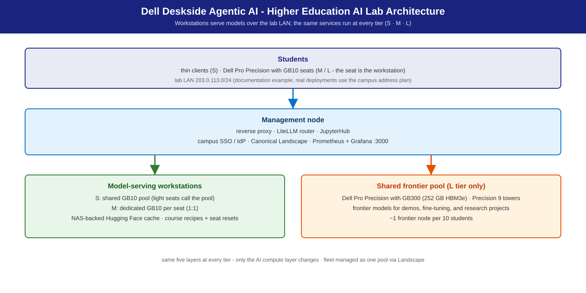
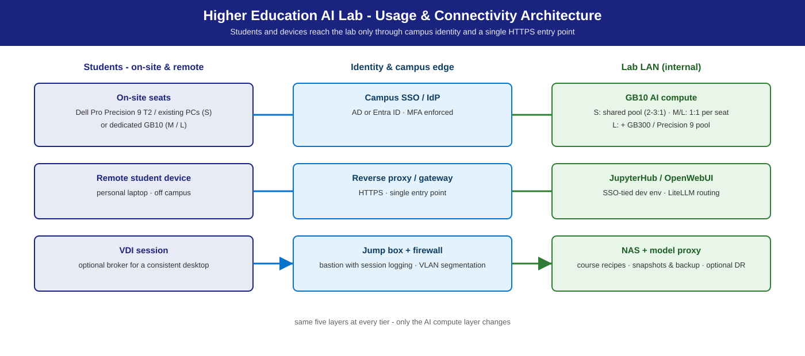

# Higher Education AI Lab

**A repeatable design for university AI teaching labs on Dell deskside
hardware — multi-cohort teaching: coding agents, video search &
summarization, and agent runtimes.**

## Summary

Universities need AI compute close to the classroom, manageable by campus IT,
and strong enough for modern coursework. This template serves models in [vLLM](https://github.com/vllm-project/vllm)
containers on Dell deskside workstations; students connect over the lab LAN
with OpenAI-compatible clients, and course lifecycle is a fleet operation —
one managed fleet serves many courses (N×M scheduling) with fast state reset
between classes. It wraps three NVIDIA playbooks and cross-links the sibling
solutions supplying the course modules:
[Agentic Coding](../agentic-coding/) (coding agents),
[Agentic Video Search & Summarization](../agentic-vss/) (video search & summarization), and
[OpenClaw on NemoClaw](../openclaw-on-nemoclaw/) (agent runtimes; advanced modules via
[Hermes on NemoClaw](../hermes-on-nemoclaw/)).

**Reference design.** Pool sizing comes from measured ladders on the same hardware
([Benchmarks & performance](#benchmarks-performance-validation)); your pilot observations tune it.

## Personas

| Persona | What this solution gives them |
|---------|-------------------------------|
| **IT Admin** | Lab architecture, fleet management ([Landscape](https://ubuntu.com/landscape) ), imaging, NAS, identity, semester playbook — [IT-Admin Guide](it-admin-guide.md). |
| **Faculty / department** | Course profiles, N×M scheduling, app stack, curriculum progression by tier. |
| **AI engineer / lab admin** | Model serving, [LiteLLM](https://www.litellm.ai/) routing, GB10 pooling — [Developer Deploy Guide](deploy-guide-dev.md). |
| **Institutional leadership** | Sizing comparison, TCO framework, phased roadmap. |

More: [Personas](../../docs/personas.md).

## Reference NVIDIA playbooks

| Playbook | Platform | What Dell adds |
|----------|----------|----------------|
| [CLI Coding Agent](https://build.nvidia.com/spark/cli-coding-agent) | DGX Spark (GB10) | Multi-seat serving, course profiles, sizing — module in [Agentic Coding](../agentic-coding/) |
| [Run NemoClaw with a Local LLM](https://build.nvidia.com/spark/nemoclaw) | DGX Spark (GB10) | Per-student agent runtime + sandbox, reset between classes — module in [OpenClaw on NemoClaw](../openclaw-on-nemoclaw/) |
| [Video Search & Summarization blueprint](https://github.com/NVIDIA-AI-Blueprints/video-search-and-summarization) | Spark / RTX PRO / GB300 | Classroom-scale VSS module, public images, VLM + LLM local — module in [Agentic Video Search & Summarization](../agentic-vss/) |

The [RTX Local AI hub](https://build.nvidia.com/rtx) covers the discrete
RTX PRO options used by the M-tier shared amplifier.

## Use cases

Teaching scenarios on a 30-seat reference lab:

| Teaching scenario | Tier | Cohort / sizing | What it looks like |
|-------------------|------|-----------------|--------------------|
| Intro AI / ML coursework | S | 30 students, 10–15 serving GB10s (2–3:1) | JupyterHub notebooks on a shared vLLM endpoint; prompt engineering, RAG, light fine-tuning. |
| Dedicated AI teaching lab | M | 30 seats, 1:1 | Each seat is a Dell Pro Precision with GB10 (128 GB unified); local development, zero contention. |
| Coding-agent / multi-agent coursework | M | 1:1 seats | Per-student CLI coding agents  (Agentic Coding) or agent runtime + sandbox  ([NemoClaw](https://github.com/NVIDIA/NemoClaw)). |
| Graduate research / fine-tuning | L | 30 seats + shared pool (~1:10) | Frontier pool for fine-tuning and dense-model assignments. |
| Video-understanding coursework | L | shared pool | VSS teaching module on the shared compute  (Agentic Video Search & Summarization). |
| Cross-departmental + remote | S | N courses × M seats, one fleet | CS one hour, digital humanities the next; reset between classes. Remote cohorts join via reverse proxy or campus VDI broker. |

Course profiles cover: notebook + local LLM · multi-model comparison (via
LiteLLM) · fine-tuning (Unsloth Studio) · RAG (`nomic-embed-text`) · creative
(ComfyUI + FLUX.1-dev / SDXL) · multimedia (Whisper large-v3).

What this template is *not*: hardware procurement; a curriculum (faculty pick
content); a research-cluster substitute (L shared compute is classroom-scale).

## Architecture



Usage and connectivity — students and devices reach the lab only through campus
identity and one HTTPS entry point (view as published in the launch brochure):



Lab topology — workstations serve models over the lab LAN (doc-example range
203.0.113.0/24; real deployments use the campus address plan):

```
 Students: thin clients (S) · GB10 seats (M/L — the seat is the workstation)
        │  lab LAN 203.0.113.0/24 (doc example)
        ▼
 Management node — reverse proxy · LiteLLM router · JupyterHub
 (campus SSO/IdP · Landscape · Prometheus + Grafana :3000)
        │
 ┌──────┴──────────────────────────────┐
 ▼                                     ▼
 Model-serving workstations           Shared frontier pool (L only)
 GB10 pool / seats · optional         Dell Pro Precision with GB300 (~1:10)
 Precision 9 T4/T6 RTX PRO 6000             vLLM · public images
 (multi-instance or TP)
        │
        ▼
 NAS / NFS — weights · datasets · course profiles · home dirs
 (model proxy/cache · snapshots for between-class reset)
```

Shared infra (all tiers): NAS/NFS + model proxy/cache · Landscape 
fleet management · campus SSO/IdP (LDAP/AD) · optional remote access (proxy /
jump host / VDI broker).

## S / M / L sizing

Tiers differ by **seat ratio and serving topology**, not by stack
([S/M/L Sizing](../../docs/sizing.md)).

| Tier | Lab model | Dell systems | Model (default · alt) | Expected |
|------|-----------|--------------|------------------------|----------|
| **S** | Shared serving pool + thin clients | **Dell Pro Precision with GB10** (128 GB unified) ×N, 2–3 students per node | [Nemotron 3.5 Lightning](https://huggingface.co/nvidia/NVIDIA-Nemotron-3.5-Lightning-30B-A3B-NVFP4) 30B A3B · alt [Qwen3.8 27B](https://huggingface.co/nvidia/Qwen3.8-27B-NVFP4) (+ MTP) | 1 vLLM per GB10 behind LiteLLM; interactive at 2–3 students/node (measured GB10 ladders below) |
| **M** | 1:1 seats | **Dell Pro Precision with GB10** per seat — the workstation **is** the endpoint; optional **Dell Pro Precision 9 T4** (RTX PRO 6000, multi-instance or TP) shared amplifier | [Nemotron 3.5 Super VL](https://huggingface.co/nvidia/NVIDIA-Nemotron-3.5-Super-VL-120B-A12B-NVFP4) · alt [Qwen3.8-Flash-Next](https://huggingface.co/nvidia/Qwen3.8-Flash-Next-NVFP4) | per-seat local serving; optional shared T4/T6 amplifier |
| **L** | 1:1 seats + shared frontier pool | GB10 seats + **Dell Pro Precision with GB300** (252 GB HBM3e, aarch64), ~1 per 10 students | Nemotron 3.5 Super VL · alt [GLM-5.3-Flash](https://huggingface.co/RedHatAI/GLM-5.3-Flash-NVFP4) | shared frontier pool (GB300 session envelope at a 20 tok/s/session floor — [Agentic Coding](../agentic-coding/)) |

All NVFP4. Rule of thumb (inherited from the measured Agentic Coding S-tier
baseline): one GB10 comfortably serves 2–3 concurrent notebook students at
interactive latency — a 30-seat lab wants 10–15 GB10s in the pool. App
stack: JupyterHub, OpenWebUI, vLLM/Ollama on all tiers; Unsloth Studio,
ComfyUI, [OpenCode](https://opencode.ai/) on M/L seats; LiteLLM routing on S/L pools.

## Model recommendation

Per-course model choice, not one model for every course; pin the default and
route alternatives through LiteLLM (one endpoint per student, routing by API
key / course group).

- **Default (S, all coursework):** **Nemotron 3.5 Lightning 30B A3B NVFP4**
  ([card](https://huggingface.co/nvidia/NVIDIA-Nemotron-3.5-Lightning-30B-A3B-NVFP4))
  — instruction, coding, RAG; runs on every tier. Reasoning model: clients
  need `max_tokens >= 512`. M/L shared serving default:
  **Nemotron 3.5 Super VL**; Lightning is the measured alternative.
- **Alts, same API:** S / coding-heavy CS — **Qwen3.8 27B NVFP4**
  ([card](https://huggingface.co/nvidia/Qwen3.8-27B-NVFP4)); M / shared
  amplifier — **Qwen3.8-Flash-Next NVFP4**
  ([card](https://huggingface.co/nvidia/Qwen3.8-Flash-Next-NVFP4)); L /
  frontier coursework — **GLM-5.3-Flash NVFP4**
  ([card](https://huggingface.co/RedHatAI/GLM-5.3-Flash-NVFP4)), a 320B-total
  MoE on one 252 GB GB300.
- **Comparison labs:** [Gemma 4 26B A4B](https://huggingface.co/google/gemma-4-26B-A4B-it) **and** [Gemma 4 31B](https://huggingface.co/google/gemma-4-31B-it) (dense), side by
  side via LiteLLM. **RAG:** `nomic-embed-text` + the default chat model.
- **VSS teaching module:** [Nemotron 3 Nano Omni](https://huggingface.co/nvidia/nemotron-3-nano-omni-30b-a3b) (VLM) + Lightning (LLM), both
  local on public `vllm/vllm-openai` images — [Agentic Video Search & Summarization](../agentic-vss/).
- **Creative / multimedia:** FLUX.1-dev / SDXL (ComfyUI), Whisper large-v3.

## Inference stack

**vLLM (preferred)** — OpenAI-compatible, public `vllm/vllm-openai` images
([docs.vllm.ai](https://docs.vllm.ai/)). Ollama is the per-seat developer
quick-start; LiteLLM fronts shared pools for multi-model routing. Reference:
[Inference Stack & Models](../../docs/stack.md).

## Deployment recipes

Catalog: [`docs/recipes/`](../../docs/recipes/) ·
[Dell Deskside Agentic AI Solutions](../../README.md).

| Platform | Recipe (under `recipes/`) | Lab role |
|----------|--------|----------|
| GB10 | [`gb10/vllm/docker-nemotron-3.5-lightning-nvfp4.sh`](../../recipes/gb10/vllm/docker-nemotron-3.5-lightning-nvfp4.sh) | S pool · M/L seats |
| GB10 | [`gb10/vllm/docker-qwen3.8-27b-nvfp4.sh`](../../recipes/gb10/vllm/docker-qwen3.8-27b-nvfp4.sh) | coding-heavy courses (S alt) |
| Precision | [`precision/vllm/docker-nemotron-3.5-lightning-nvfp4.sh`](../../recipes/precision/vllm/docker-nemotron-3.5-lightning-nvfp4.sh) | shared amplifier, multi-instance or TP |
| Precision | [`precision/vllm/docker-qwen3.8-flash-next-nvfp4.sh`](../../recipes/precision/vllm/docker-qwen3.8-flash-next-nvfp4.sh) | M-tier alt |
| GB300 | [`gb300/vllm/docker-nemotron-3.5-lightning-nvfp4.sh`](../../recipes/gb300/vllm/docker-nemotron-3.5-lightning-nvfp4.sh) | L shared pool (measured fallback) |
| GB300 | [`gb300/vllm/docker-glm-5.3-flash-nvfp4.sh`](../../recipes/gb300/vllm/docker-glm-5.3-flash-nvfp4.sh) | L-tier alt (frontier) |

_Commands in this guide run from the repository root (`git clone` this repo and `cd` into it)._

```bash
recipes/gb10/vllm/docker-nemotron-3.5-lightning-nvfp4.sh --port 8000
curl -s http://localhost:8000/v1/models
```

JupyterHub / OpenWebUI / VSS classroom profiles run as inline Compose in the
dev guide. Guides — pilot:
[Developer Deploy Guide](deploy-guide-dev.md) · semester rollout:
[IT-Admin Guide](it-admin-guide.md).

## Management environment

- **Fleet:** Canonical Landscape — golden image, patching,
  per-course profile push; rollouts run without SSH.
- **Identity:** campus SSO / IdP (AD, Entra ID, LDAP) with per-course group
  scoping; students never see a raw serving port.
- **Monitoring:** [Prometheus](https://prometheus.io/) + [Grafana](https://grafana.com/) (`:3000`) + DCGM — GPU use, vLLM queue
  depth, storage growth, fleet health.
- **Course lifecycle (N×M):** container reset ~2 s (profile / model swap) ·
  LVM snapshot restore ~30 s (home dirs) · autoinstall re-image 3–5 min
  (end of term).

## Benchmarks & performance (validation)

Classroom sizing is derived from measured ladders on the same hardware rather than a replay of a 30-seat class:
the S pool from the GB10 ladders (Lightning chat: ~44 tok/s per session alone, ~31 at four concurrent sessions), the L
pool from the GB300 ladders (Super VL chat: ~74 tok/s per session at 32 concurrent). Reset times depend on your storage
(a container reset takes seconds; see the [IT-Admin Guide](it-admin-guide.md) for snapshot restore and re-image). The
measured Agentic Coding S-tier baseline (GB10, 200/200 chat, prior reference model;
[Agentic Coding](../agentic-coding/)) is kept below for pool sizing:

| Concurrent students | TTFT p50 | Notes |
|--------------------:|---------:|-------|
| 1 | ~113 ms | Excellent |
| 4 | ~267 ms | Good — interactive coding |
| 8 | ~348 ms | Acceptable — light lag on first token |
| 16 | ~583 ms | Marginal — add a second GB10 to the pool |

## Cost & TCO

Indicative BOM cost ratios for a 30-seat lab (order-of-magnitude planning,
not quotes):

| Component | S | M | L |
|-----------|---|---|---|
| Compute | 1.0× | 3.0× | 4.5× |
| Storage + network | 0.3× | 0.3× | 0.5× |
| Ops / management | 0.5× | 0.3× | 0.5× |
| **Total** | ~1.8× | ~3.6× | ~5.5× |

Storage planning (30 seats, one term, indicative): weights 200–500 GB on NAS
· datasets 100–200 GB/course · home dirs 20–40 GB × 30 · +25 % snapshot
overhead → **~2–3 TB usable NAS**. S is cheapest at the cost of contention;
M removes contention at ~2× S compute; L adds fine-tuning and frontier
coursework at ~1.5× M compute.

## Dependencies & risk factors

- **Dependencies:** the three upstream playbooks; vLLM public images on
  GB10 / Precision / GB300; [Hugging Face](https://huggingface.co/) access (or a pre-seeded model proxy)
  for first weight pull; campus IdP; Landscape.
- **Risk factors:** model lineup refreshes with the
  open-weights cadence; undersized S pools degrade TTFT under concurrent use
  — plan from the inherited ladder and pilot observations.
