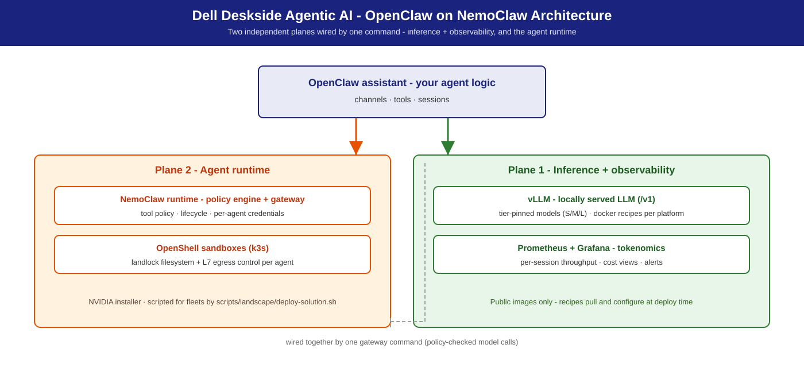

# OpenClaw on NemoClaw

**The [OpenClaw](https://openclaw.ai/) assistant on NVIDIA's [NemoClaw](https://github.com/NVIDIA/NemoClaw) runtime — agent lifecycle, policy engine, and [OpenShell](https://github.com/NVIDIA/OpenShell) sandbox — backed by a locally-served LLM on Dell deskside hardware.**

## Summary

[NemoClaw](https://github.com/NVIDIA/NemoClaw) is NVIDIA's runtime for autonomous, tool-using AI agents: agent
lifecycle, declarative policy engine, OpenShell sandbox. This solution binds
it to a locally-served LLM ([vLLM](https://github.com/vllm-project/vllm), tuned public-image recipes in this repo) so
the full agent loop — reasoning, tool execution, policy enforcement — stays on
your Dell workstation, no cloud dependency. NemoClaw onboards a supported agent — by default [OpenClaw](https://openclaw.ai/), the open-source assistant — so what this solution actually runs is **OpenClaw on NemoClaw**; swap in your own agent or Hermes on the same base. Dell adds S/M/L sizing,
serving recipes, validation numbers, and fleet guidance on top of NVIDIA's
NemoClaw playbooks and the RTX Local AI hub.

This is the **base runtime**. For the shipping tool-using agent, use
[Hermes on NemoClaw](../hermes-on-nemoclaw/) — [Hermes](https://hermes-agent.nousresearch.com/) runs on this
substrate. Teams building their **own** agents start here.

## Personas

| Persona | What this solution gives them |
|---------|-------------------------------|
| **IT Admin** | Two-plane rollout (serving + runtime), fleet install, policy tiers — [IT-Admin Guide](it-admin-guide.md). |
| **Functional SME** | "Which system for my team size?" — the S/M/L table + measured per-tier concurrency. |
| **AI Engineer** | Runtime + sandbox + policy for custom agents, wired to a local OpenAI-compatible LLM — [Developer Deploy Guide](deploy-guide-dev.md). |

## Reference NVIDIA playbooks

| Playbook | Platform | What Dell adds |
|----------|----------|----------------|
| [Run NemoClaw with a Local LLM (Spark)](https://build.nvidia.com/spark/nemoclaw) | DGX Spark (GB10) | Dell sizing, tuned vLLM recipes (public images), fleet mgmt |
| [Run NemoClaw with a Local LLM (Station)](https://build.nvidia.com/station/nemoclaw) | DGX Station (GB300) | L-tier sizing, multi-agent app-host config |
| [Secure AI Agents with OpenShell](https://build.nvidia.com/spark/openshell) | DGX Spark (GB10) | Enterprise policy-tier guidance (`strict` → `standard`) |
| [Build and Deploy a Multi-Agent Chatbot](https://build.nvidia.com/spark/multi-agent-chatbot) | DGX Spark (GB10) | Multi-instance serving, per-agent policy tiers |
| [RTX Local AI hub](https://build.nvidia.com/rtx) | RTX PRO discrete GPUs (Precision towers) | T2/T4/T6 tier recipes and validation |

## Use cases

| Use case | What it looks like |
|----------|--------------------|
| **Custom in-house agent** | NemoClaw provides sandbox, policy, and LLM binding; you write the agent logic and tool wiring. |
| **Multi-agent workflows** | Multiple sandboxes on one runtime — research, drafting, review — each with its own policy tier, sharing one local vLLM endpoint. |
| **Policy-first evaluation** | Run a candidate agent under `strict` policy (read-only allowlist, egress whitelist, no subprocess); widen only as behavior is validated. |
| **Managed tool / MCP access** | MCP servers run outside the sandbox with scoped credentials; the agent calls tools through the MCP client — raw credentials never enter the sandbox. |
| **Headless / remote deployment** | Runs headlessly on a workstation reached over SSH; an always-on agent on the corporate network. |
| **Airgapped / regulated** | LLM on the same box, MCP servers on-site, `strict` policy denies all non-whitelisted egress. |

What NemoClaw is **not**: not the agent (your logic, or Hermes), not a hosted
service, not an LLM, not a policy language.

## Architecture



Two independent planes, wired together by one command:

| Plane | Contents | Install path |
|-------|----------|--------------|
| **1 — Inference + observability** | vLLM + [Prometheus](https://prometheus.io/) + [Grafana](https://grafana.com/) | [Docker](https://www.docker.com/) recipes under `recipes/` (public images only) |
| **2 — Agent runtime** | NemoClaw + OpenShell (k3s + policy engine + sandboxes) | NVIDIA installer, scripted for fleets by `scripts/landscape/deploy-solution.sh` |

The agent loop, end to end:

```
        Your custom agent (agent logic runs here)
                     │
      ┌──────────────▼───────────────────────────────┐
      │  Plane 2 — NemoClaw runtime                  │
      │    agent lifecycle ── MCP client             │
      │    policy engine ─── gates fs / net / subproc│
      │    OpenShell sandbox (k3s + landlock)        │
      └────┬─────▲─────────────────────┬─────────────┘
tool_use   │     │ tool result         │ completions
           ▼     │                     ▼
   Sandboxed tools /       Plane 1 — vLLM /v1 (OpenAI-compatible, :8000)
   MCP servers                      │
   (credentialed,             Prometheus :9090 ◄─ Grafana :3000
    outside sandbox)            (scrape vLLM /metrics)

        Dell deskside system (S: GB10 / T2 · M: T4 · L: GB300 / T6)
```

**Components.** `NemoClaw runtime` — agent lifecycle: create / list / connect
sandboxes, wire providers, apply policy. `OpenShell` — secure sandbox on k3s:
long-running sessions, filesystem landlock, L7 network policy, subprocess
isolation. `Policy engine` — declarative per-sandbox rules; shipped tiers
`strict` (read-only allowlist, whitelisted egress, no subprocess) →
`standard` (enterprise default) → `permissive` (never in production).

Plane 1 uses only public images, pinned in `recipes/versions.lock` (vLLM,
Prometheus, Grafana, LiteLLM); Plane 2 installs via NVIDIA's shipping
installer, tracking NVIDIA's release cadence.

## S / M / L sizing

| Tier | Dell system | Model (default · alt) | Quant | vLLM config | Expected (agent turn, wall p50) |
|------|-------------|-----------------------|-------|-------------|-------------------------------|
| **S** | **Dell Pro Precision with GB10** (128 GB) | [Nemotron-3.5-Lightning-30B-A3B](https://huggingface.co/nvidia/NVIDIA-Nemotron-3.5-Lightning-30B-A3B-NVFP4) · alt [Qwen3.8 27B NVFP4](https://huggingface.co/nvidia/Qwen3.8-27B-NVFP4) | NVFP4 | `--moe-backend marlin --kv-cache-dtype fp8 --max-model-len 200000 --max-num-seqs 32 --gpu-memory-utilization 0.7` | ~11–23 s, 1–2 interactive agents |
| **S** | **Precision T2** (1× RTX PRO 6000) | [Nemotron-3.5-Lightning-30B-A3B](https://huggingface.co/nvidia/NVIDIA-Nemotron-3.5-Lightning-30B-A3B-NVFP4) · alt [Qwen3.8 27B NVFP4](https://huggingface.co/nvidia/Qwen3.8-27B-NVFP4) | NVFP4 | `--moe-backend marlin --kv-cache-dtype fp8 --max-model-len 200000 --max-num-seqs 512 --gpu-memory-utilization 0.9` | **~3–4 s @ c1–c4** (fastest S) |
| **M** | **Precision T4** (2× RTX PRO 6000, 192 GB) | [Nemotron 3.5 Super VL](https://huggingface.co/nvidia/NVIDIA-Nemotron-3.5-Super-VL-120B-A12B-NVFP4) · alt [Qwen3.8-Flash-Next NVFP4](https://huggingface.co/nvidia/Qwen3.8-Flash-Next-NVFP4) | NVFP4 | multi-instance or TP=2 | ~9–12 s @ c1–c4 (harness reference) |
| **L** | **Dell Pro Precision with GB300** (252 GB HBM3e, aarch64) | Nemotron 3.5 Super VL · alt [GLM-5.3-Flash](https://huggingface.co/RedHatAI/GLM-5.3-Flash-NVFP4) NVFP4 | NVFP4 | single instance | ~8–12 s @ c1–c4 (harness reference); 1–4+ concurrent, headroom above tested range |
| **L** | **Precision T6** (5× RTX PRO 6000, 480 GB) | Nemotron 3.5 Super VL · alt [GLM-5.3-Flash](https://huggingface.co/RedHatAI/GLM-5.3-Flash-NVFP4) NVFP4 | NVFP4 | 1 instance/GPU + gateway | ~8–12 s @ c1–c4 (harness reference); 1–4+ concurrent |

Sizing framework: [S/M/L Sizing](../../docs/sizing.md). Custom
agents follow this envelope for the LLM half; tool-execution cost adds on top —
measure it.

## Model recommendation

Tool-calling quality is a **hard requirement** for agent workloads. Every pick
below has verified tool calling on the exact serving flags shown; mismatched
tool/reasoning parsers break tool-calling silently.

- **S default:** [nvidia/NVIDIA-Nemotron-3.5-Lightning-30B-A3B-NVFP4](https://huggingface.co/nvidia/NVIDIA-Nemotron-3.5-Lightning-30B-A3B-NVFP4)
  — MoE, NVFP4, GB10 → GB300. **M/L default: Nemotron 3.5 Super VL**
  (Lightning multi-instance is the measured fallback).
  Parsers: `--enable-auto-tool-choice --tool-call-parser qwen3_coder
  --reasoning-parser nemotron_v3` (baked into the recipes).
- **S alt:** [nvidia/Qwen3.8-27B-NVFP4](https://huggingface.co/nvidia/Qwen3.8-27B-NVFP4)
  (+ MTP) — `recipes/gb10/vllm/docker-qwen3.8-27b-nvfp4.sh`; parsers
  `qwen3_coder` / `qwen3`.
- **M alt:** [nvidia/Qwen3.8-Flash-Next-NVFP4](https://huggingface.co/nvidia/Qwen3.8-Flash-Next-NVFP4)
  (MTP ×3, engram CPU offload) —
  `recipes/precision/vllm/docker-qwen3.8-flash-next-nvfp4.sh`; parsers
  `qwen3_xml` / `qwen3`.
- **L alt:** [RedHatAI/GLM-5.3-Flash-NVFP4](https://huggingface.co/RedHatAI/GLM-5.3-Flash-NVFP4)
  (320B/18B-active MoE, 262K ctx) —
  `recipes/gb300/vllm/docker-glm-5.3-flash-nvfp4.sh`; parsers
  `glm47` / `glm45`.

## Inference stack

**vLLM (preferred)** — OpenAI-compatible, production-grade, the basis for all
sizing numbers; tuned recipes apply:

```
--kv-cache-dtype fp8 --max-num-seqs 32/256/512 --max-model-len 200000
--enable-auto-tool-choice --tool-call-parser qwen3_coder
--reasoning-parser nemotron_v3
_Commands in this guide run from the repository root (`git clone` this repo and `cd` into it)._

```

Tool-calling reference: <https://docs.vllm.ai/>. Ollama / NIM:
[Inference Stack & Models](../../docs/stack.md).

## Deployment recipes

| Dell system | Default recipe |
|-------------|----------------|
| GB10 | `recipes/gb10/vllm/docker-nemotron-3.5-lightning-nvfp4.sh` |
| Precision T2 / T4 | `recipes/precision/vllm/docker-nemotron-3.5-lightning-nvfp4.sh` |
| GB300 | `recipes/gb300/vllm/docker-nemotron-3.5-lightning-nvfp4.sh` |

Catalog: [`docs/recipes/`](../../docs/recipes/). Two-step quick start
(for a fleet, `scripts/landscape/deploy-solution.sh` runs both steps):

```bash
# 1. Plane 1 — serve the local LLM
recipes/<platform>/vllm/docker-nemotron-3.5-lightning-nvfp4.sh --port 8000
curl -s http://localhost:8000/v1/models

# 2. Plane 2 — NemoClaw installer + OpenShell
curl -fsSL https://www.nvidia.com/nemoclaw.sh | bash
export PATH="$HOME/.local/bin:$PATH"

# 3. Wire agent inference to Plane 1
openshell provider create --name vllm-local --type openai \
  --credential OPENAI_API_KEY=local \
  --config base_url=http://host.docker.internal:8000/v1
openshell inference set --provider vllm-local --model nvidia/nemotron-3.5-lightning
openshell status              # Connected
```

Full guides: [Developer Deploy Guide](deploy-guide-dev.md) ·
[IT-Admin Guide](it-admin-guide.md).

## Benchmarks & performance (validation)

S-tier reference platform (Dell Precision T2 class, RTX PRO 6000 Blackwell
96 GB, [Nemotron 3.5 Lightning NVFP4](https://huggingface.co/nvidia/NVIDIA-Nemotron-3.5-Lightning-30B-A3B-NVFP4)).

**Serving layer** (raw vLLM, aiperf, concurrency 1 → 256, 0 request errors):

| Concurrency | p99 TTFT | Aggregate output tok/s | Notes |
|------------:|---------:|-----------------------:|-------|
| 8 | ≤ 170 ms | Comfortable interactive | |
| 32 | ≤ 170 ms | Comfortable interactive | |
| 64 | ≤ 264 ms | Interactive ceiling | |
| 128 | ~500 ms | Batch-only | |
| 256 | ~916 ms | ~5,352 tok/s aggregate (published chat-sweep peak) |

**Agent layer** (real agent turn — plan → tool_call → recover → finalize:
3 `POST /v1/chat/completions` calls in ~3 s of LLM time, ~4 s wall clock;
grounded tool exec verified end-to-end). Hermes-shaped harness, default model,
100 % task success:

| Tier | Concurrency 1 wall p50 | Concurrency 2 wall p50 | Concurrency 4 wall p50 |
|------|-----------------------:|-----------------------:|-----------------------:|
| S — Dell Pro Precision with GB10 | ~11 s | ~15 s | ~23 s |
| S — Precision T2 | ~3 s | ~3 s | ~4 s |
| M — Precision T4 | ~9 s | ~11 s | ~12 s |
| L — Precision T6 (1 GPU) | ~10 s | ~10 s | ~12 s |
| L — Dell Pro Precision with GB300 | ~8 s | ~8 s | ~8 s |

**Guidance:** GB10 1–2 concurrent interactive agents (4 batch); T2 1–4; T4
1–4; T6 1–4 per GPU (one instance per GPU behind a router); GB300 1–4+,
headroom above the tested range. S-tier serving ceiling ~32–64 concurrent
interactive requests. Validated on reference hardware; your workloads will
vary.

## Management environment

- **Fleet:** Ubuntu [Landscape](https://ubuntu.com/landscape) script execution for Plane 1 rollout.
- **Identity:** your gateway / reverse proxy for AD/LDAP-backed auth on
  multi-user tiers.
- **Monitoring:** every Plane 1 recipe starts the shared tokenomics Prometheus + Grafana
  (`monitoring/README.md`: tokens, cloud-equivalent vs on-prem cost, utilisation, TTFT, KV cache,
  queue). KV-cache > 90 % sustained (alert shipped) → shorten context or cut concurrency.
  NemoClaw agent telemetry is not collected by this repo.

## Dependencies & risk factors

- **Dependencies:** NemoClaw + OpenShell NVIDIA installer (NVIDIA's cadence);
  vLLM on GB10 / RTX PRO Blackwell / GB300; HF access to Nemotron 3.5
  Lightning NVFP4; tool-call-capable lineup above.
- **Risk factors:** tool-execution cost is design-dependent and can dominate
  LLM cost; model-specific tool-parser flags.

## Related

- [Hermes on NemoClaw](../hermes-on-nemoclaw/) — shipping tool-using
  agent on this runtime.
- [Agentic Coding](../agentic-coding/) ·
  [Agentic Video Search & Summarization](../agentic-vss/) — companions sharing the Plane 1
  endpoint.
- [`docs/recipes/`](../../docs/recipes/) ·
  [Dell Deskside Agentic AI Solutions](../../README.md) — catalog, repo overview.
